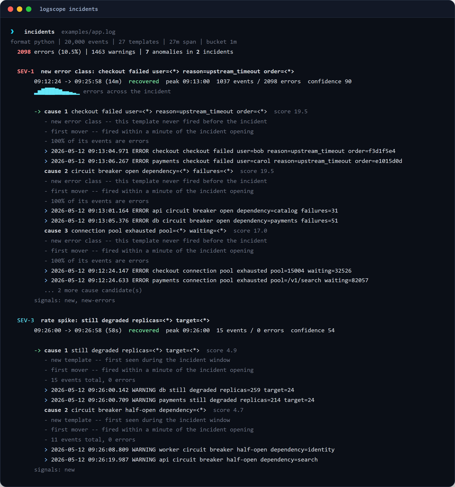
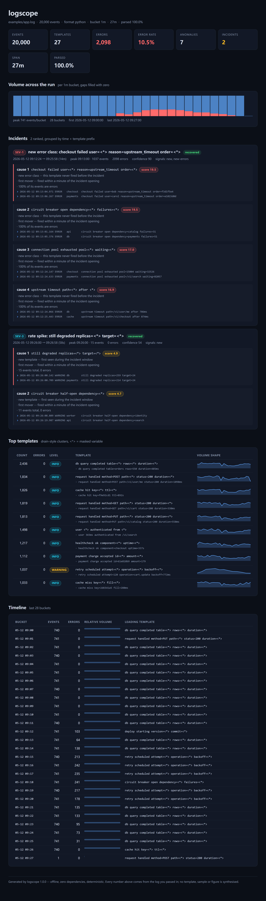

# logscope

**Point logscope at 20,000 lines of log and get back the incident, its ranked causes, and the exact lines that prove it.**

[](https://github.com/kele-tao/logscope/actions/workflows/ci.yml)




`logscope incidents examples/app.log --top 2` -- the terminal view. The same data
rendered by `logscope report` is below.

## The problem

Something broke at 09:12. You have the log. It is 20,000 lines of mostly
identical `INFO` noise, the incident itself is spread over four unrelated
templates, and `grep ERROR` gives you 2,098 hits that are 100% true and 0%
useful. The real questions -- *when did this start, what changed first, which
template is the cause and which are just symptoms* -- are exactly the questions
a line-by-line reading cannot answer, and by the time a human has skimmed the
file the incident is an hour old.

Existing tools solve slices of this. `grep`/`awk` count lines but do not
understand templates. Grafana/Loki and Elastic need a cluster, an index and an
ingest pipeline before you can ask anything. Paid APM products answer this well,
but only for logs that already flow into them. There was no *read the file you
already have, on your laptop, in one command* option.

`logscope` is that option: one file, zero dependencies, no network, and a ranked
answer before your coffee finishes brewing.

## What it does

- **Streams five log dialects with constant memory.** JSON lines, RFC 5424 and
  RFC 3164 syslog, nginx/apache combined access logs, Python `logging` output,
  and a timestamp-scavenging fallback for everything else. Auto-detection samples
  the head of the file and shows its work (`logscope formats`).
- **Mines templates Drain-style instead of grepping.** Variables are masked to
  `<*>`, so `user alice failed from 10.0.0.1` and `user bob failed from 10.0.0.2`
  collapse into one template. Values that carry meaning -- `status=500` vs
  `status=200` -- are deliberately *not* masked, so an error class stays distinct
  from a success.
- **Detects four kinds of anomaly** against a rolling baseline: rate spikes
  (EWMA + robust z-score), trailing bursts, first-seen templates after a quiet
  period, and brand-new error classes. Each anomaly carries a one-line
  explanation written for a human, not a dashboard.
- **Groups anomalies into incidents** by time proximity *and* template relation,
  merging overlapping windows -- one outage with four symptoms is one incident
  with four ranked causes, not four incidents.
- **Ranks root causes with evidence.** Severity first, then novelty, first-mover
  timing and error density. Every candidate lists why it was chosen and quotes the
  raw lines that put it there.
- **Renders a self-contained dark HTML report** with inline SVG sparklines: no
  CDN, no JavaScript, no fonts to fetch. Open it on a plane.
- **Fits a CI gate.** `--fail-on error` exits 1 when a critical incident exists;
  `--json` gives you the same numbers programmatically.

## Install

logscope is **not on PyPI yet**. Install from source -- it is a single package
with no runtime dependencies:

```bash
git clone https://github.com/kele-tao/logscope
cd logscope
pip install -e .

# or run it without installing
python -m logscope --help
```

Requires Python 3.10+. Nothing else.

## Usage

### 1. Get the picture in one command

```console
$ logscope analyze examples/app.log --top 8
  analyze  examples/app.log
format python | 20,000 events | 27 templates | 27m span | bucket 1m
  2098 errors (10.5%) | 1463 warnings | 7 anomalies in 2 incidents

  volume ███████████████████████████   peak 741/bucket

  TEMPLATES BY VOLUME
     count     err  level     first seen  template
     2,436       0  INFO      09:00:00    db query completed table=<*> rows=<*> duration=<*>
     1,834       0  INFO      09:00:02    request handled method=POST path=<*> status=200 duration=<*>
     1,826       0  INFO      09:00:01    cache hit key=<*> ttl=<*>
     1,819       0  INFO      09:00:00    request handled method=GET path=<*> status=200 duration=<*>
     1,813       0  INFO      09:00:00    request handled method=PUT path=<*> status=200 duration=<*>
     1,498       0  INFO      09:00:00    user <*> authenticated from <*>
     1,217       0  INFO      09:00:00    healthcheck ok component=<*> uptime=<*>
     1,112       0  INFO      09:00:00    payment charge accepted id=<*> amount=<*>
  ... 19 more templates (raise --top to see them)

  FINDINGS 2 incident(s), 7 anomalies -- run 'logscope incidents' for the timeline
  SEV-1  new error class: checkout failed user=<*> reason=upstream_timeout order=<*>
  SEV-3  rate spike: still degraded replicas=<*> target=<*>
```

### 2. Get the incident, its causes and the evidence

```console
$ logscope incidents examples/app.log --top 1
  SEV-1  new error class: checkout failed user=<*> reason=upstream_timeout order=<*>
       09:12:24 -> 09:25:58 (14m)  recovered  peak 09:13:00  1037 events / 2098 errors  confidence 90
       ▂▅▇███▇▆▄▄▃▂▁ errors across the incident

       -> cause 1 checkout failed user=<*> reason=upstream_timeout order=<*>  score 19.5
          - new error class -- this template never fired before the incident
          - first mover -- fired within a minute of the incident opening
          - 100% of its events are errors
          > 2026-05-12 09:13:04.971 ERROR checkout checkout failed user=bob reason=upstream_timeout order=f3d1f5e4
          > 2026-05-12 09:13:06.267 ERROR payments checkout failed user=carol reason=upstream_timeout order=e1015d0d
          cause 2 circuit breaker open dependency=<*> failures=<*>  score 19.5
          - new error class -- this template never fired before the incident
          - first mover -- fired within a minute of the incident opening
          - 100% of its events are errors
          > 2026-05-12 09:13:01.164 ERROR api circuit breaker open dependency=catalog failures=31
          > 2026-05-12 09:13:05.376 ERROR db circuit breaker open dependency=payments failures=51
          cause 3 connection pool exhausted pool=<*> waiting=<*>  score 17.0
          - new error class -- this template never fired before the incident
          - first mover -- fired within a minute of the incident opening
          - 100% of its events are errors
          > 2026-05-12 09:12:24.147 ERROR checkout connection pool exhausted pool=15004 waiting=32526
          > 2026-05-12 09:12:24.633 ERROR payments connection pool exhausted pool=/v1/search waiting=82057
          ... 2 more cause candidate(s)
       signals: new, new-errors
```

Note what the tool found without being told anything: the deploy moved first,
the checkout failure is a template that **never existed before minute 12**, and
it accounts for 100% errors. Nothing about that story is hard-coded -- the same
binary finds the equivalent story in an nginx access log, where the incident
shows up as `status=503` appearing for the first time at minute 13.

### 3. Get a shareable HTML report

```console
$ logscope report examples/app.log --out report.html
wrote report.html (28,938 bytes, 2 incidents, 7 anomalies)
```

The file is a single self-contained document: inline SVG charts, inline CSS, no
scripts and no external requests. The volume chart stacks the error share on top
of total traffic in red -- which is why the incident at 09:12 is visible at a
glance even though total throughput never moved. A committed sample lives at
[docs/report-sample.html](docs/report-sample.html) (screenshotted below) and the
nginx equivalent at [docs/nginx-report.html](docs/nginx-report.html).



### 4. Other workflows

```console
$ logscope timeline examples/app.log --since 09:10 --until 09:20
  bucket         events   errors   new  leading template
  05-12 09:10       741        0    15  ... db query completed table=<*> rows=<*> duratio…
  05-12 09:11       740        0     0  ... db query completed table=<*> rows=<*> duratio…
  05-12 09:12       741      103     6  ... deploy starting version=<*> commit=<*>
  05-12 09:13       741       64     3  ... db query completed table=<*> rows=<*> duratio…
  05-12 09:14       741      138     0  ... db query completed table=<*> rows=<*> duratio…
  05-12 09:15       740      213     0  ... retry scheduled attempt=<*> operation=<*> bac…
  05-12 09:16       741      242     0  ... retry scheduled attempt=<*> operation=<*> bac…
  05-12 09:17       741      235     0  ... retry scheduled attempt=<*> operation=<*> bac…
  05-12 09:18       741      241     0  ... circuit breaker open dependency=<*> failures=…
  05-12 09:19       740      217     0  ... retry scheduled attempt=<*> operation=<*> bac…

  10 buckets | 0 anomalies | 0 still open at end of log
```

```console
$ logscope formats examples/nginx.log
examples/nginx.log  (200 sampled lines)

     jsonl         0
     syslog        0
  -> cli         600
     python        0
     text        200

  detected: cli
```

```console
$ tail -f /var/log/app.log | logscope analyze - --grep timeout --min-level ERROR --json
$ logscope incidents app.log --fail-on error   # exits 1 when a SEV-1 exists
$ echo $?
1
```

### Flags that matter

| Flag | Meaning |
| --- | --- |
| `--format auto\|jsonl\|syslog\|cli\|python\|text` | force a dialect instead of auto-detecting |
| `--bucket 30s\|1m\|5m\|1h` | histogram width; default is chosen from the log span |
| `--since` / `--until` | ISO timestamps, or clock times like `09:12`, or relative `15m`/`2h`/`1d` |
| `--grep REGEX` / `--invert` | keep/drop events whose raw line matches |
| `--min-level LEVEL` | DEBUG, INFO, WARNING, ERROR, CRITICAL |
| `--threshold 0-1` | template similarity; lower merges more aggressively (default 0.7) |
| `--top N` | how many templates / incidents / rows to show |
| `--json` | machine-readable output on every analysis command |
| `--fail-on warning\|error\|any` | exit 1 when findings reach that level |
| `--color auto\|always\|never` | ANSI control, honours `NO_COLOR` and `FORCE_COLOR` |

### Exit codes

| Code | Meaning |
| --- | --- |
| 0 | analysis completed, nothing crossed `--fail-on` |
| 1 | findings crossed the `--fail-on` threshold (CI gate failed) |
| 2 | usage error: bad flag, unreadable file, unparsable time, bad regex |

## How it works

```mermaid
flowchart LR
    A[log file / stdin] --> B{detect dialect}
    B --> C[jsonl | syslog | cli | python | text]
    C --> D[normalise Event: ts, level, message]
    D --> E[tokenize + mask variables]
    E --> F[template cluster bucket]
    F --> G[(per-template histogram)]
    G --> H[EWMA / z-score spike]
    G --> I[trailing burst]
    G --> J[first-seen template]
    G --> K[new error class]
    H --> L[anomaly + explanation]
    I --> L
    J --> L
    K --> L
    L --> M[group by time + template prefix]
    M --> N[rank root causes]
    N --> O[terminal | JSON | HTML]
```

Each line is parsed to an `Event` (timestamp, level, message, source) and
immediately folded into a template cluster; nothing is retained per line, so
memory stays flat as the file grows. A cluster is keyed by its masked token
sequence. New masked sequences are compared against at most 64 live candidates
inside a bucket keyed by token count and first token, using a positional
similarity walk; anything above `--threshold` merges, anything below becomes a
new template. The hot path memoises the variable detector and short-circuits
repeats through an exact-match dictionary, which is what keeps a 5 MB file under
two seconds.

Detection is deliberately simple and explainable rather than a black box. Every
template keeps a per-minute histogram. The spike detector trains an EWMA over
the first five buckets, then flags any later bucket that is both above the EWMA
and several robust deviations (MAD-based) away from it *and* at least twice the
expected rate. The burst detector compares the trailing 8% of buckets to the
file-wide average, which catches storms that never look unusual minute-to-minute
but dominate the tail. The new-error detector fires when a WARNING-or-worse
template's first occurrence lands after the warm-up window -- the classic 'error
class we have never seen before' that means a deploy changed failure modes.

Incidents are formed by joining anomalies that are within three buckets *and*
related (same template prefix, same template, a shared literal token, or both
error-class). Overlapping windows are merged iteratively. Root causes are then
ranked by an explicit rubric -- new error class, first mover, error density,
volume -- rather than by adding raw scores together, because a z-score of 20 and
a count of 1000 are not the same unit and a chatty warning template must not
beat the error class that actually broke.

## Design decisions

**1. Zero runtime dependencies, including the report.** The tempting move is
`jinja2` for the HTML and `jsonschema` for config. Both would double the
install size and the audit surface for output that is generated exactly once.
The report is 250 lines of `%`-formatting with an inline SVG sparkline builder,
which is also why it can be opened from a USB stick with no network. The cost is
that the HTML is composed by hand and must be escaped carefully;
`test_html_report_escapes_untrusted_text` exists precisely because of that risk.

**2. Templates over full-text search.** Elasticsearch-style tokenisation would
be faster to write and much worse to read: the output is a hits list, not a
story. Masking to a skeleton is what turns 20,000 lines into 27 templates and
makes 'this error class never existed before 09:13' a question you can actually
ask. The tradeoff is that masking is heuristic -- a variable that looks like a
literal word (a username with no digits) needs the small `_MASK_NEXT_AFTER` key
list to be caught, and that list will never be complete.

**3. Explainable heuristics over a learned model.** A learned anomaly detector
would likely score better on a benchmark and be impossible to trust in an
incident: 'why did it flag this?' has to have an answer you can paste into a
ticket. Every anomaly therefore carries a sentence naming its statistic and its
threshold, and every root cause names the rubric items that earned it points.
The tradeoff is obvious and documented in [docs/ROADMAP.md](docs/ROADMAP.md):
this will miss anomalies that do not look like a spike, a burst or a new class.

## Performance

Measured with `python benchmarks/run.py` (median of 3 runs, in-process, on the
machine that built this release; your laptop will differ). The script generates
its own inputs with `benchmarks/gen.py`, so these numbers are reproducible:

```
| input | MB | median | throughput | templates | anomalies | incidents | peak MiB |
| --- | ---: | ---: | ---: | ---: | ---: | ---: | ---: |
| 5,000 lines | 0.46 | 0.08s | 5.9 MB/s | 27 | 5 | 1 | 0.2 |
| 20,000 lines | 1.85 | 0.31s | 6.0 MB/s | 27 | 7 | 2 | 0.2 |
| 60,000 lines | 5.56 | 1.71s | 3.3 MB/s | 27 | 7 | 2 | 0.8 |
```

Peak memory is measured with `tracemalloc` for the small inputs. For the scale
test the harness spawns `logscope` as a separate process and polls its working set
through `psapi` (Windows) or `getrusage` (POSIX), so the number is the real
high-water mark of a real run:

```
scale: 2,100,000 lines, 194.6 MB -> 44.3s end-to-end, 22.0 MiB peak RSS, 4.4 MB/s
```

That is the whole point of streaming, stated honestly. A 195 MB log takes 44
seconds and **22 MiB of resident memory** -- of which ~19 MiB is the Python
interpreter itself, as the 20,000-line run above shows. Memory does not grow with
the file; time does. If you need to grep 200 MB in two seconds, use `ripgrep`;
logscope spends its time building templates and baselines, which is the part that
answers the question.

The two hot spots were found by profiling and fixed rather than papered over: the
variable detector is memoised (`lru_cache`) because tokens repeat heavily inside
one log, and repeated masked sequences short-circuit through a dictionary before
the similarity walk. Together they took the 5.56 MB case from 6.9 s to the number
in the table. Reproduce all of it with `python benchmarks/run.py --scale`.

## Comparison

| | logscope | [Drain3](https://github.com/logpai/Drain3) | [GoAccess](https://goaccess.io/) | Grafana Loki |
| --- | --- | --- | --- | --- |
| Install | `pip install -e .` (stdlib only) | pip + numpy/scipy | C binary | server + agents |
| Input | 5 dialects, auto-detected | text lines you pre-parse | web access logs only | needs a pipeline |
| Finds incidents | yes, grouped and ranked | no (templates only) | no (traffic stats) | via LogQL you write |
| Root-cause ranking | yes, with evidence and reasons | no | no | no |
| HTML report offline | yes, single file | no | yes | no |
| Runs on a laptop, no service | yes | yes (library) | yes | no |

Drain3 is the reference implementation of the mining algorithm this borrows from,
and it is a better *library* for embedding template extraction in a larger
pipeline -- more mature, more configurable, actively maintained. GoAccess is
better than logscope at what it does: real-time web-log dashboards with a
beautiful TUI, and it understands far more access-log formats than the four
status families here. Loki is the right answer once you need retention, queries
across services and alerting. logscope is deliberately none of those things: it
is the thing you run when you have one file and five minutes.

## Roadmap

See [docs/ROADMAP.md](docs/ROADMAP.md) for the full honest list. The short
version:

1. **Stack folding** -- multi-line tracebacks are currently N events; this is the
   biggest quality gap for application logs.
2. **Per-host baselines** -- `--group-by host` so api-01 spiking while api-02
   stays flat is detected as a host problem, not a service-wide one.
3. **Multi-file ingestion** -- currently one path per run (stdin accepts a
   concatenation). Deliberately cut from v1.0 rather than half-built.
4. **SARIF / JUnit output** so `--fail-on` findings surface in code scanning.
5. **A `logscope.toml`** to pin or suppress known templates without lowering the
   global threshold.

## Contributing

Issues and pull requests are welcome. Read [CONTRIBUTING.md](CONTRIBUTING.md);
the short version is: no new dependencies without a justification, every
behaviour gets a test, and every number in this README must come from a command
someone else can run. Security policy in [SECURITY.md](SECURITY.md).

```bash
git clone https://github.com/kele-tao/logscope && cd logscope
pip install -e ".[dev]"
ruff check . && pytest -q
```

## License

MIT (c) 2026 kele. See [LICENSE](LICENSE).