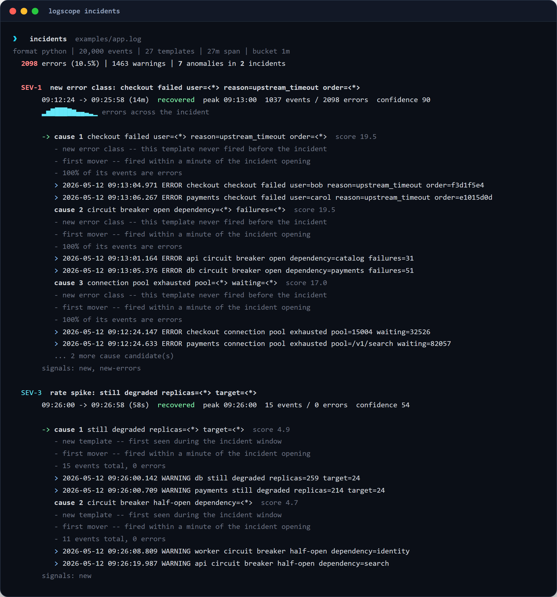
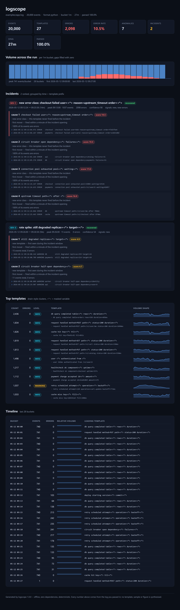

# logscope

[English](README.md) | **简体中文**

**把 logscope 指向两万行日志，拿回来的是这次故障事件本身、按可能性排序的原因，以及能证明结论的那几行原始日志。**

[](https://github.com/kele-tao/logscope/actions/workflows/ci.yml)




上面是 `logscope incidents examples/app.log --top 2` 的终端输出。同一份数据经
`logscope report` 渲染后的结果在下方。

## 问题

09:12 出了故障，日志在你手上。这 20,000 行里大部分是彼此雷同的 `INFO` 噪音，故障本身
散落在四个互不相关的模板里，而 `grep ERROR` 给你 2,098 条命中——100% 真实，0% 有用。
真正要回答的问题是：*它什么时候开始的、最先变化的是什么、哪个模板是原因、哪些只是
症状*。这些恰恰是逐行阅读答不出来的问题，而等人把文件扫完一遍，故障已经过去一小时了。

现有工具各自解决了其中一片。`grep`/`awk` 能数行数，但不懂模板。Grafana/Loki 和
Elastic 需要集群、索引和采集管道，然后你才能开始提问。付费 APM 产品在这件事上做得
很好，但只对已经流入它们的日志有效。此前没有一种选择是*在你自己的笔记本上、用一条命令、读你已经有的那个文件*。

`logscope` 就是这种选择：一个文件、零依赖、不联网，在你等咖啡泡好的时间里给出一个
排好序的答案。

## 它能做什么

- **以恒定内存流式解析五种日志方言。** JSON lines、RFC 5424 与 RFC 3164 syslog、
  nginx/apache combined 访问日志、Python `logging` 的输出，以及为其他格式准备的
  时间戳兜底解析路径。自动检测会采样文件头部，并把判断过程展示出来（`logscope formats`）。
- **用 Drain 风格做模板抽取，而不是 grep。** 变量被掩码成 `<*>`，
  于是 `user alice failed from 10.0.0.1` 和 `user bob failed from 10.0.0.2`
  会归并成同一个模板。而承载语义的取值——`status=500` 对 `status=200`——故意*不*
  掩码，这样错误类型才能与成功类型区分开。
- **针对滚动基线检测四类异常**：速率尖峰（EWMA + 稳健 z-score）、尾部突发、安静期之后首次出现的模板，以及全新的错误类型。每条异常都附带一句写给人看的解释，而不是给仪表盘看的。
- **把异常聚合成故障事件**，依据是时间邻近*以及*模板关联，重叠的时间窗会被合并——
  一次持续中断即使有四个症状，也仍然是一个事件、四个排好序的原因，而不是四个事件。
- **带证据给根因排序。** 先看严重程度，再看新颖度、谁先发生以及错误密度。每个候选
  原因都会说明它为什么被选中，并引用把它放上去的原始日志行。
- **渲染一份自包含的深色 HTML 报告**，内联 SVG 迷你走势图：没有 CDN、没有 JavaScript、不需要拉取字体。在飞机上也能打开。
- **可以当 CI 门禁。** `--fail-on error` 在存在严重故障事件时以退出码 1 结束；
  `--json` 以程序可读的形式给出同样的数字。

## 安装

logscope **尚未发布到 PyPI**。请从源码安装——它是一个单包项目，没有运行时依赖：

```bash
git clone https://github.com/kele-tao/logscope
cd logscope
pip install -e .

# or run it without installing
python -m logscope --help
```

需要 Python 3.10+，别无其他。

## 用法

### 1. 一条命令看清全局

```console
$ logscope analyze examples/app.log --top 8
  analyze  examples/app.log
format python | 20,000 events | 27 templates | 27m span | bucket 1m
  2098 errors (10.5%) | 1463 warnings | 7 anomalies in 2 incidents

  volume ███████████████████████████   peak 741/bucket

  TEMPLATES BY VOLUME
     count     err  level     first seen  template
     2,436       0  INFO      09:00:00    db query completed table=<*> rows=<*> duration=<*>
     1,834       0  INFO      09:00:02    request handled method=POST path=<*> status=200 duration=<*>
     1,826       0  INFO      09:00:01    cache hit key=<*> ttl=<*>
     1,819       0  INFO      09:00:00    request handled method=GET path=<*> status=200 duration=<*>
     1,813       0  INFO      09:00:00    request handled method=PUT path=<*> status=200 duration=<*>
     1,498       0  INFO      09:00:00    user <*> authenticated from <*>
     1,217       0  INFO      09:00:00    healthcheck ok component=<*> uptime=<*>
     1,112       0  INFO      09:00:00    payment charge accepted id=<*> amount=<*>
  ... 19 more templates (raise --top to see them)

  FINDINGS 2 incident(s), 7 anomalies -- run 'logscope incidents' for the timeline
  SEV-1  new error class: checkout failed user=<*> reason=upstream_timeout order=<*>
  SEV-3  rate spike: still degraded replicas=<*> target=<*>
```

### 2. 拿到事件、原因和证据

```console
$ logscope incidents examples/app.log --top 1
  SEV-1  new error class: checkout failed user=<*> reason=upstream_timeout order=<*>
       09:12:24 -> 09:25:58 (14m)  recovered  peak 09:13:00  1037 events / 2098 errors  confidence 90
       ▂▅▇███▇▆▄▄▃▂▁ errors across the incident

       -> cause 1 checkout failed user=<*> reason=upstream_timeout order=<*>  score 19.5
          - new error class -- this template never fired before the incident
          - first mover -- fired within a minute of the incident opening
          - 100% of its events are errors
          > 2026-05-12 09:13:04.971 ERROR checkout checkout failed user=bob reason=upstream_timeout order=f3d1f5e4
          > 2026-05-12 09:13:06.267 ERROR payments checkout failed user=carol reason=upstream_timeout order=e1015d0d
          cause 2 circuit breaker open dependency=<*> failures=<*>  score 19.5
          - new error class -- this template never fired before the incident
          - first mover -- fired within a minute of the incident opening
          - 100% of its events are errors
          > 2026-05-12 09:13:01.164 ERROR api circuit breaker open dependency=catalog failures=31
          > 2026-05-12 09:13:05.376 ERROR db circuit breaker open dependency=payments failures=51
          cause 3 connection pool exhausted pool=<*> waiting=<*>  score 17.0
          - new error class -- this template never fired before the incident
          - first mover -- fired within a minute of the incident opening
          - 100% of its events are errors
          > 2026-05-12 09:12:24.147 ERROR checkout connection pool exhausted pool=15004 waiting=32526
          > 2026-05-12 09:12:24.633 ERROR payments connection pool exhausted pool=/v1/search waiting=82057
          ... 2 more cause candidate(s)
       signals: new, new-errors
```

注意工具在没有被告知任何事情的情况下找到了什么：部署是最先动的，checkout 失败对应的
模板**在第 12 分钟之前根本不存在**，它的错误占比是 100%。这个故事没有任何硬编码——
同一个可执行文件能在 nginx 访问日志里找到等价的故事，那里故障表现为 `status=503` 在
第 13 分钟第一次出现。

### 3. 拿到一份可分享的 HTML 报告

```console
$ logscope report examples/app.log --out report.html
wrote report.html (28,938 bytes, 2 incidents, 7 anomalies)
```

这个文件是一份自包含的单文档：内联 SVG 图表、内联 CSS，没有脚本，也没有任何外部请求。
流量图用红色把错误占比叠在总流量之上——这正是为什么 09:12 的故障一眼可见，尽管整体吞吐
从未变化。仓库里有一份提交好的样例
[docs/report-sample.html](docs/report-sample.html)（截图见下），对应的 nginx 版本在
[docs/nginx-report.html](docs/nginx-report.html)。



### 4. 其他工作流

```console
$ logscope timeline examples/app.log --since 09:10 --until 09:20
  bucket         events   errors   new  leading template
  05-12 09:10       741        0    15  ... db query completed table=<*> rows=<*> duratio…
  05-12 09:11       740        0     0  ... db query completed table=<*> rows=<*> duratio…
  05-12 09:12       741      103     6  ... deploy starting version=<*> commit=<*>
  05-12 09:13       741       64     3  ... db query completed table=<*> rows=<*> duratio…
  05-12 09:14       741      138     0  ... db query completed table=<*> rows=<*> duratio…
  05-12 09:15       740      213     0  ... retry scheduled attempt=<*> operation=<*> bac…
  05-12 09:16       741      242     0  ... retry scheduled attempt=<*> operation=<*> bac…
  05-12 09:17       741      235     0  ... retry scheduled attempt=<*> operation=<*> bac…
  05-12 09:18       741      241     0  ... circuit breaker open dependency=<*> failures=…
  05-12 09:19       740      217     0  ... retry scheduled attempt=<*> operation=<*> bac…

  10 buckets | 0 anomalies | 0 still open at end of log
```

```console
$ logscope formats examples/nginx.log
examples/nginx.log  (200 sampled lines)

     jsonl         0
     syslog        0
  -> cli         600
     python        0
     text        200

  detected: cli
```

```console
$ tail -f /var/log/app.log | logscope analyze - --grep timeout --min-level ERROR --json
$ logscope incidents app.log --fail-on error   # exits 1 when a SEV-1 exists
$ echo $?
1
```

### 值得记住的参数

| 参数 | 含义 |
| --- | --- |
| `--format auto\|jsonl\|syslog\|cli\|python\|text` | 强制指定方言，而不是自动检测 |
| `--bucket 30s\|1m\|5m\|1h` | 直方图宽度；默认值根据日志跨度选择 |
| `--since` / `--until` | ISO 时间戳，或 `09:12` 这样的时刻，或 `15m`/`2h`/`1d` 这样的相对时间 |
| `--grep REGEX` / `--invert` | 保留、丢弃原始日志行匹配的事件 |
| `--min-level LEVEL` | DEBUG、INFO、WARNING、ERROR、CRITICAL |
| `--threshold 0-1` | 模板相似度；越低合并越激进（默认 0.7） |
| `--top N` | 展示多少个模板、事件、行 |
| `--json` | 所有分析命令都支持机器可读的输出 |
| `--fail-on warning\|error\|any` | 发现达到该级别时以退出码 1 结束 |
| `--color auto\|always\|never` | ANSI 控制，遵循 `NO_COLOR` 与 `FORCE_COLOR` |

### 退出码

| 退出码 | 含义 |
| --- | --- |
| 0 | 分析完成，没有任何发现触及 `--fail-on` |
| 1 | 发现触及了 `--fail-on` 阈值（CI 门禁失败） |
| 2 | 用法错误：参数不合法、文件不可读、时间无法解析、正则无效 |

## 工作原理

```mermaid
flowchart LR
    A[log file / stdin] --> B{detect dialect}
    B --> C[jsonl | syslog | cli | python | text]
    C --> D[normalise Event: ts, level, message]
    D --> E[tokenize + mask variables]
    E --> F[template cluster bucket]
    F --> G[(per-template histogram)]
    G --> H[EWMA / z-score spike]
    G --> I[trailing burst]
    G --> J[first-seen template]
    G --> K[new error class]
    H --> L[anomaly + explanation]
    I --> L
    J --> L
    K --> L
    L --> M[group by time + template prefix]
    M --> N[rank root causes]
    N --> O[terminal | JSON | HTML]
```

每一行先被解析成一个 `Event`（时间戳、级别、消息、来源），随即折叠进模板簇；没有任何
按行驻留的数据，所以随着文件变大，内存保持平稳。一个簇以它的掩码 token 序列为键。新的掩码
序列会与最多 64 个活跃候选比较，候选放在以 token 数量和首个 token 为键的桶里，用位置相似度
走查完成比较；超过 `--threshold` 的合并，低于的成为新模板。热路径对变量检测器做了记忆化，并用精确匹配字典
短路重复序列——正是这一点让 5 MB 的文件能在两秒内跑完。

检测部分刻意做得简单且可解释，而不是一个黑盒。每个模板维护一份按分钟的直方图。尖峰检测器
用前五个桶训练 EWMA，然后标记之后的桶：既要高于 EWMA，又要偏离它若干个稳健偏差（基于 MAD），
*并且*至少达到预期速率的两倍。突发检测器把尾部 8% 的桶与全文件平均值比较，它能抓住那种逐分钟
看并不异常、却主宰了尾部的风暴。新错误检测器在某个 WARNING 及以上级别的模板首次出现落在预热
窗口之后时触发——就是那种经典的「从未见过的错误类型」，通常意味着某次部署改变了失败模式。

故障事件由异常连接而成：它们必须落在三个桶之内*并且*彼此相关（相同模板前缀、相同模板、共享
字面量 token，或两者都是错误类型）。重叠的时间窗会被迭代合并。根因随后按一套明确的评分规则
排序——新错误类型、谁先发生、错误密度、量级——而不是把原始分数相加，因为 z-score 的 20 和
数量 1000 不是同一个量纲，一个话多的告警模板不该压过真正出问题的那个错误类型。

## 设计取舍

**1. 零运行时依赖，报告也不例外。** 诱人的做法是用 `jinja2` 生成 HTML、用 `jsonschema`
处理配置。两者都会让安装体积和审计面翻倍，而输出只生成一次。报告是 250 行 `%` 格式化
代码加上一个内联 SVG 走势图构建器，这也是它能从 U 盘里离线打开的原因。代价是 HTML 由手工拼装，必须小心转义；
`test_html_report_escapes_untrusted_text` 的存在正是因为这一风险。

**2. 模板优先于全文检索。** Elasticsearch 风格的 token 化写起来更快、读起来差得多：输出是一张
命中列表，而不是一个故事。掩码成骨架，正是把 20,000 行变成 27 个模板的原因，也让「这个错误类型在
09:13 之前从未出现过」成为一个真能问出口的问题。取舍在于掩码是启发式的——一个看起来像普通单词
的变量（例如不含数字的用户名）需要靠那份小小的 `_MASK_NEXT_AFTER` 关键词列表才能被捕捉到，
而这份列表永远不会完整。

**3. 可解释的启发式，而不是学出来的模型。** 学习型异常检测器在基准测试上可能分数更高，但在故障
现场无法被信任：「它为什么报这个？」必须有一个能贴进工单的答案。因此每条异常都带一句话，点名它
用的统计量和阈值；每个根因都点名它靠哪些评分项得分。取舍很明显，也写在
[docs/ROADMAP.md](docs/ROADMAP.md) 里：不在尖峰、突发或新类型之列的异常会被漏掉。

## 性能

由 `python benchmarks/run.py` 测得（3 次运行取中位数，进程内测试，跑在构建本次发布的机器上；
你的笔记本会不同）。脚本用 `benchmarks/gen.py` 自己生成输入，所以这些数字可复现：

```
| input | MB | median | throughput | templates | anomalies | incidents | peak MiB |
| --- | ---: | ---: | ---: | ---: | ---: | ---: | ---: |
| 5,000 lines | 0.46 | 0.08s | 5.9 MB/s | 27 | 5 | 1 | 0.2 |
| 20,000 lines | 1.85 | 0.31s | 6.0 MB/s | 27 | 7 | 2 | 0.2 |
| 60,000 lines | 5.56 | 1.71s | 3.3 MB/s | 27 | 7 | 2 | 0.8 |
```

峰值内存对小输入用 `tracemalloc` 测量。规模测试里，测试框架把 `logscope` 作为独立进程启动，
通过 `psapi`（Windows）或 `getrusage`（POSIX）轮询它的工作集，所以这个数字是一次真实运行的
真实高水位：

```
scale: 2,100,000 lines, 194.6 MB -> 44.3s end-to-end, 22.0 MiB peak RSS, 4.4 MB/s
```

这就是流式处理的意义所在，如实陈述。一份 195 MB 的日志跑 44 秒，占用 **22 MiB 常驻内存**——其中
约 19 MiB 是 Python 解释器本身，正如上面 20,000 行那次运行所示。内存不随文件增长，时间才会。如果你
需要两秒内 grep 完 200 MB，请用 `ripgrep`；logscope 把时间花在构建模板和基线上，而那才是回答
问题的那部分。

两个热点是通过性能剖析找到并修掉的，不是遮掩过去：变量检测器做了记忆化（`lru_cache`），因为在
一份日志里 token 重复度很高；重复的掩码序列在相似度走查之前经字典短路。两者合起来把 5.56 MB 的
用例从 6.9 s 降到表里的数字。用 `python benchmarks/run.py --scale` 可以完整复现。

## 对比

| | logscope | [Drain3](https://github.com/logpai/Drain3) | [GoAccess](https://goaccess.io/) | Grafana Loki |
| --- | --- | --- | --- | --- |
| 安装 | `pip install -e .`（仅标准库） | pip + numpy/scipy | C 二进制 | 服务端 + 代理 |
| 输入 | 5 种方言，自动检测 | 需要你先解析好的文本行 | 仅 Web 访问日志 | 需要一条采集管道 |
| 找出故障事件 | 是，已分组并排序 | 否（只有模板） | 否（流量统计） | 需你自写 LogQL |
| 根因排序 | 是，带证据和理由 | 否 | 否 | 否 |
| 离线 HTML 报告 | 是，单文件 | 否 | 是 | 否 |
| 在笔记本上跑，无需服务 | 是 | 是（作为库） | 是 | 否 |

Drain3 是这套挖掘算法所借鉴的参考实现，如果要把模板抽取嵌进更大的管道，
它是更好的*库*——更成熟、更可配置、有活跃维护。GoAccess 在它擅长的方向上强于 logscope：实时 Web 日志仪表盘，配一个漂亮的
TUI，而且它理解的访问日志格式远多于这里支持的四个状态码族。
一旦你需要保留期、跨服务查询和告警，Loki 才是正确答案。logscope 刻意哪一样都不做：它就是你在手上只有一个文件、只有五分钟时该跑的那个东西。

## 路线图

完整的、不打折扣的清单见 [docs/ROADMAP.md](docs/ROADMAP.md)。简版：

1. **堆栈折叠**——多行 traceback 目前会被算成 N 个事件；这是应用日志上最大的质量缺口。
2. **按主机基线**——`--group-by host`，让 api-01 尖峰而 api-02 平稳这件事被识别为主机问题，而不是
   服务级问题。
3. **多文件输入**——目前每次运行只能读一个路径（stdin 可以接受拼接内容）。这一项被刻意从 v1.0 砍掉，
   而不是做成半成品。
4. **SARIF / JUnit 输出**，让 `--fail-on` 的发现能进代码扫描。
5. **一个 `logscope.toml`**，用于固定或屏蔽已知模板，同时不必降低全局阈值。

## 参与贡献

欢迎提交 issue 和 pull request。请先读 [CONTRIBUTING.md](CONTRIBUTING.md)，简版是：没有正当理由不加新依赖、
每个行为都要有测试、这份 README 里的每个数字都必须来自别人能跑的命令。安全策略见
[SECURITY.md](SECURITY.md)。

```bash
git clone https://github.com/kele-tao/logscope && cd logscope
pip install -e ".[dev]"
ruff check . && pytest -q
```

## 许可证

MIT (c) 2026 kele。见 [LICENSE](LICENSE)。
